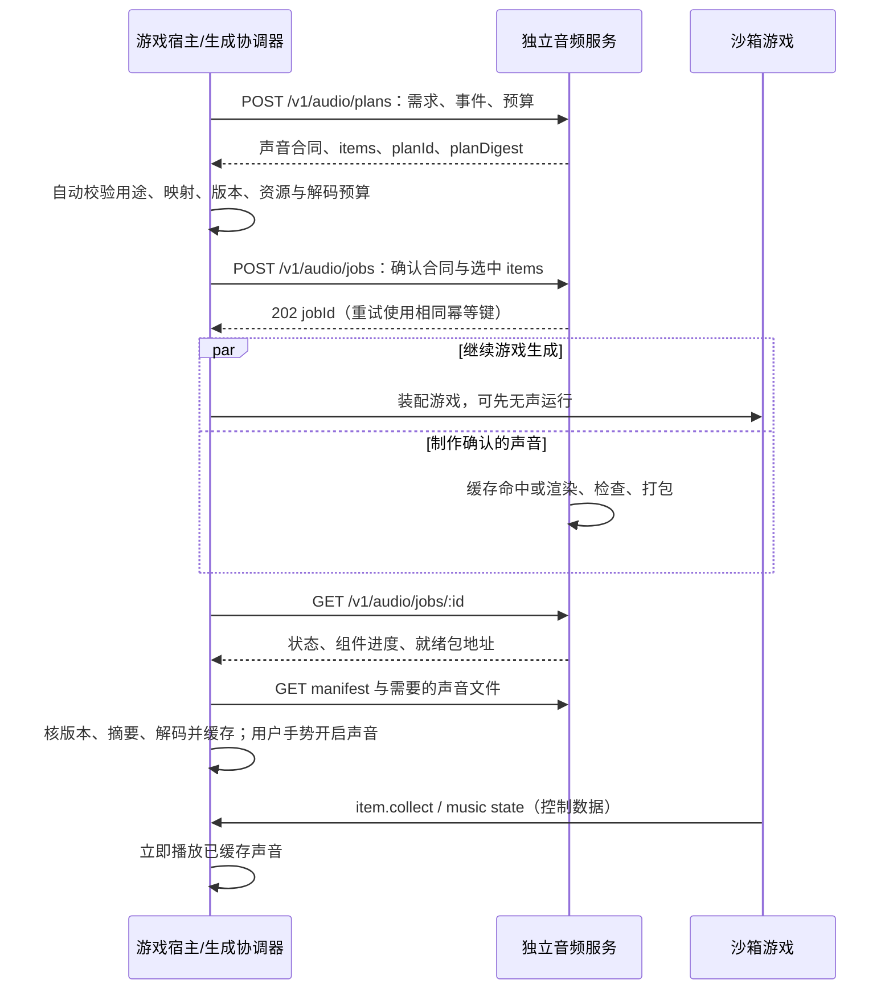

# 宿主与音频服务如何交互

版本：接入说明 0.1 / 后续协议 proposal-v1，2026-11-16。

采用「声明需要什么 → 返回声音合同 → 宿主自动校验并确认 → 生成并交付所选声音 →
游戏本地播放」的合作方式。这里的确认是程序校验，不要求玩家逐个批准声音。
游戏动作使用稳定 ID，例如 `item.collect`；BGM 使用独立音乐 ID，例如
`bgm.exploration`。宿主掌握玩法与生命周期，音频项目负责声音设计、制作与交付。

## 当前可调用的接口与后续接口

| 层次 | 接口 | 当前状态 |
|---|---|---|
| 查询能力 | `GET /api/audio/capabilities` | 已实现，本地研究服务器 |
| 生成声音计划 | `POST /api/audio/plan` | 已实现，返回谱面与事件绑定，不返回音频文件 |
| 校验 / 渲染 / 播放 | 宿主调用 JS 模块与 Web Audio | 已实现，见下文和 `pipeline.html` |
| 沙箱游戏发声音事件 | `GameAudio.emit/setScene/setIntensity` | 已实现，MessageChannel 通信 |
| 需求协商 | `POST /v1/audio/plans` | 下文的后续协议，尚未实现 |
| 确认选项并生成 | `POST /v1/audio/jobs` | 后续协议，尚未实现 |
| 查询进度 / 获取媒体包 | `/v1/audio/jobs/:id`、`/v1/audio/packages/:digest/manifest` | 后续协议，尚未实现 |

`/api/audio/plan` 是当前原型接口；`/v1/audio/*` 是下一阶段独立服务协议。
不能把后者复制到当前服务器就期待产生音频文件。当前 `createAudioPackage(plan)`
也只导出源合同，`files: []`、`mediaStatus: "not-rendered"`。

生成接口只在生成、重试或修改设计时调用。拾取发生时调用的是已准备好的播放接口，
不逐次请求服务器制作声音，也不逐次下载同一段 WAV。播放器、网络请求和资源缓存由
可信宿主持有；沙箱游戏只发送合同内的控制消息。

## 当前版本：现在就能对接

### 1. 查询能力与提交共享需求

启动 `npm start`，默认地址为 `http://127.0.0.1:4178`。
`GET /api/audio/capabilities` 当前返回：

```json
{
  "schemaVersion": 1,
  "director": "local-rule-based-research-prototype",
  "profiles": ["cozy", "neon", "ruins"],
  "rendering": "browser-web-audio-offline",
  "eventBridge": "message-channel-v1"
}
```

将游戏生成任务使用的同一份 `gameBrief` 和 `eventContract` 交给音频项目。
完整可用请求见 [audio-plan-request.json](../examples/audio-plan-request.json)。
它声明了必需的拾取音效、可选的受击音效，以及共享游戏描述中的海岛配乐需求。
当前一次计划生成一首 BGM；尚不支持通过音乐 ID 选择多首曲目。

PowerShell：

```powershell
$body = Get-Content -Raw -Encoding utf8 examples/audio-plan-request.json
$result = Invoke-RestMethod -Method Post `
  -Uri http://127.0.0.1:4178/api/audio/plan `
  -ContentType 'application/json; charset=utf-8' -Body $body
$result.plan | Select-Object planId, revision, mediaStatus, bindings, audioSpec
```

macOS / Linux：

```sh
curl -sS http://127.0.0.1:4178/api/audio/plan \
  -H 'Content-Type: application/json' \
  --data-binary @examples/audio-plan-request.json
```

成功响应是 `{ "plan": ... }`，完整谱面可能较长。关键字段如下：

| 字段 | 宿主用途 |
|---|---|
| `schemaVersion`、`kind` | 确认协议版本与 `game-audio-plan` 类型 |
| `projectId/revision/briefHash/contractVersion/contractHash` | 与当前游戏共享身份逐项核对 |
| `planId`、`scoreHash` | 区分音频方案及完整谱面；改变 seed 也会改变方案 |
| `bindings["item.collect"]` | 当前为 `{cue:"collect", required:true, maxRatePerSecond:6}` |
| `audioSpec` | 风格、时长、采样率、声道、分轨、支持的渲染方式与空间能力 |
| `score` | 交给浏览器编译的谱面数据 |
| `compilerVersion/composerVersion/soundBankVersion` | 核对本地编译器和音源依赖 |
| `unmappedOptionalEvents` | 未绑定的可选事件，宿主显式处理 |
| `mediaStatus` | 当前固定 `not-rendered`，不代表声音已可播放 |

`cue` 必须来自当前支持清单，见 [game-audio-pipeline.mjs](../src/game-audio-pipeline.mjs)
的 `SUPPORTED_CUES`。`required: true` 的事件缺少映射会被拒绝；两个不同语义事件
可以复用同一个 cue。当前 `options` 的 HTTP 用法是可选的 uint32 `seed`；不要通过
JSON 传 JavaScript 导演函数。导演仍为本地规则，没有接通用 AI 音乐模型。

### 2. 宿主校验后，再开始真实渲染

当前的“确认”在宿主内执行，不需要另一个确认 HTTP 请求。以下展示最小调用顺序；
完整的 iframe 装配、取消过期任务与页面生命周期实现见
[pipeline-demo.mjs](../src/pipeline-demo.mjs)。宿主页应先加载 `vendor/Tone.js`，
并由可信装配器在首次 `bridge.connect()` 前把 `gameAudioClientSource()` 内联到游戏
iframe，确认 iframe 加载完成。bridge 不会替宿主等待 iframe 或自动安装客户端。

```js
import {
  createGameRevisionIdentity, validateGameAudioJoin,
  createGameAudioAdapter, PIPELINE_VERSIONS
} from '/src/game-audio-pipeline.mjs';
import { createAudioRuntime, renderScore } from '/src/audio-engine.mjs';
import { createGameAudioBridge } from '/src/game-audio-bridge.mjs';

// input 是宿主保存的共享请求；游戏生成任务也使用这一份输入。
const gameIdentity = await createGameRevisionIdentity(
  input.gameBrief, input.eventContract
);
const response = await fetch('/api/audio/plan', {
  method: 'POST', headers: { 'Content-Type': 'application/json' },
  body: JSON.stringify(input)
});
const body = response.headers.get('content-type')?.includes('application/json')
  ? await response.json()
  : { error: await response.text() };
if (!response.ok) throw new Error(`HTTP ${response.status}: ${body.error}`);
const { plan } = body;

const join = validateGameAudioJoin(gameIdentity, plan);
if (!join.accepted) throw new Error(`Audio join rejected: ${join.reason}`);
if (plan.schemaVersion !== 1 || plan.kind !== 'game-audio-plan' ||
    plan.compilerVersion !== PIPELINE_VERSIONS.compiler ||
    plan.soundBankVersion !== PIPELINE_VERSIONS.soundBank) {
  throw new Error('Unsupported audio plan');
}
for (const event of input.eventContract.events) {
  if (event.required && !plan.bindings[event.id]) {
    throw new Error(`Missing required sound: ${event.id}`);
  }
}

// 示例预算：实际产品自行配置。额外空间要留给音效、解码与渲染临时图。
const pcmBytes = Math.ceil(plan.score.duration * plan.audioSpec.sampleRate) *
  plan.audioSpec.channels * 4 * (1 + plan.audioSpec.stems.length);
if (!Number.isFinite(pcmBytes) || pcmBytes > 72 * 1024 * 1024) {
  throw new Error('Retained music PCM exceeds host budget');
}

// 到这里才确认该计划可接入，再支付完整 PCM 渲染成本。
const runtime = createAudioRuntime();
const adapter = createGameAudioAdapter({ plan, runtime });
const bridge = createGameAudioBridge({ iframe, plan, adapter });
const connection = await bridge.connect();
if (!connection.accepted) throw new Error(connection.reason);
const rendered = await renderScore(plan.score, { mode: 'hybrid', sampleRate: 44100 });
```

上例中的 `input` 和 `iframe` 由生成器提供；不能让游戏重新构造另一份需求再比较。
`validateGameAudioJoin` 返回 `{accepted:true}` 或 `{accepted:false,reason,field}`，
只校验共享身份，不证明音频有效、required 事件已在玩法中触发或听感合格。
PCM 预算公式计算保留的 Float32 mix 与分轨，不代表整个页面或离线渲染峰值内存。

### 3. 用户手势开启声音，游戏只调用播放事件

真实用户点击中先 `adapter.unlock()`，成功后 `adapter.start(rendered)`；只有两个
操作均返回 `accepted:true`，宿主才执行 `bridge.setEnabled(true)`。重复点击、切换
游戏或页面进入后台时应取消旧操作，完整处理见演示实现。

游戏内的实际接口：

```js
await window.GameAudio.ready; // 仅表示通道握手完成，不表示声音已经准备好

// 实际拾取结算成功时调用一次；不要在每帧重叠检测中重复触发。
const result = await window.GameAudio.emit('item.collect', {
  strength: 0.8,
  pan: 0.2
});
if (!result.accepted) console.debug('Sound unavailable:', result.reason);

await window.GameAudio.setScene('exploration');
await window.GameAudio.setIntensity(0.7);
```

当前 `strength` 为 `0..1`，`pan` 为 `-1..1`；`position` 会被明确拒绝，尚无真实
三维距离/HRTF 支持。`setScene` 只记录合同内场景，不会自动换曲；`setIntensity`
调整当前 BGM 的分轨强度。前文构想的 `audio.play()`、`audio.music.play(id)` 是将来
便于使用的 SDK 外观，不是当前已导出的函数名。

宿主负责 `adapter.pause/resume/stop/dispose`、静音与页面生命周期。后台或暂停时先
禁用 bridge；恢复播放成功后重新启用。离开游戏时分别 `bridge.dispose()` 和
`await adapter.dispose()`。游戏子页没有解锁、启动或销毁宿主音频的权限。

### 当前错误语义

| 来源 | 返回方式 | 处理方式 |
|---|---|---|
| 计划 JSON / 合同无效 | HTTP 400，`{error:string}` | 修正需求，不自动重复同一错误请求 |
| 计划请求超过 256 KiB | HTTP 413，当前为文本响应 | 缩小请求；客户端按 Content-Type 读取错误 |
| `/api/audio/plan` 方法错误 | HTTP 405，当前为文本响应 | 使用 POST |
| 游戏身份不一致 | join 的 `accepted:false` 与 reason | 丢弃迟到结果，重新取得当前版本 |
| 通道未建立 / 未启用 | `bridge-not-ready` / `audio-not-ready` | 游戏继续，不补播积压的操作音效 |
| 事件过密 / 声部占满 | `rate-limited` / `voice-budget` | 跳过该次声音，保持玩法结算 |
| 引擎或解锁失败 | adapter 的 `accepted:false`，例如 `runtime-error` | 显示音频状态，允许适当重试 |
| 桥响应超时 | `audio-response-timeout` | 该次反馈失败，不重复进行拾取结算 |

本地服务没有认证、CORS 或多用户任务隔离；跨站接入由生成器可信后端代理，当前
浏览器示例使用同源相对地址。已有 `/api/sound-bank` 是研究音源库端点，会返回全部
17 个音源，不等于已实现“仅交付本游戏所需文件”的服务。

## 后续协议：宿主确认后，按需生成并交付

本节全部 `/v1/audio/*` HTTP 接口、命名音乐槽与媒体 manifest 都是 proposal-v1。
它们尚未实现在服务器中。下面的 `example-*` ID 是示意值，真正摘要必须根据规范化
输入和实际产物计算。新增版本接口时不改变当前原型响应的含义。



### A. 声明需求，取得可确认的声音合同

`POST /v1/audio/plans` 接收当前格式的 `gameBrief`、`eventContract`、`options`，
另加 `audioRequests` 与 `delivery`。例如在上方示例请求上增加：

```json
{
  "audioRequests": [
    {
      "id": "sfx.item.collect",
      "kind": "sfx",
      "eventId": "item.collect",
      "required": true,
      "variants": 1
    },
    {
      "id": "bgm.exploration",
      "kind": "music",
      "scene": "exploration",
      "required": true,
      "loop": true,
      "playback": "mix",
      "maxDurationSeconds": 45
    }
  ],
  "delivery": {
    "mimeTypes": ["audio/wav"],
    "sampleRate": 44100,
    "channels": 2,
    "maxTransferBytes": 12582912,
    "maxDecodedPcmBytes": 67108864
  }
}
```

上例是未来请求的增补字段，不是提交到当前 `/api/audio/plan` 的新功能。
服务按能力判断是否支持；不能静默忽略音乐风格、音乐槽或资源限制后报告成功。

未来成功响应为 `{plan}`，包含 `status:"awaiting-confirmation"`、共享 `identity`、
不可变 `planId/planDigest`、`items`、`delivery` 与编译器/音源版本。
每个 item 返回请求 ID、用途、事件或场景绑定、是否必需、变体数、循环/分轨方案、
编码格式及预计传输/解码大小；预计值只供宿主规划，不当作实际文件元数据。

摘要按键排序的规范 JSON 计算 SHA-256，以 64 个小写十六进制字符传输。`planDigest`
覆盖 schema、共享 identity、seed、谱面/音效设计、items、delivery 和编译器/音源
身份；不把摘要本身、进度、临时地址或时间戳放入摘要。服务与宿主使用相同的规范化
规则，不能直接依赖对象插入顺序或把 `JSON.stringify` 的任意结果作为跨端合同。

宿主逐项确认：必需事件存在对应 SFX，BGM 对应声明的音乐槽，参数受本机播放器支持，
所选资源符合预算，五个共享身份字段与当前游戏一致。失败时记录原因并修改需求；
通过后选定 `acceptedItems`。必需项不可遗漏，可选项允许不选。合同中每个音效事件
与音乐槽都使用稳定 ID，资源文件名可以随重新生成改变。

计划创建阶段只做需求协商、结构化谱面/声音设计和估算，不启动完整媒体渲染。
服务必须保存不可变计划，才能让后续 job 精确引用；这项存储也属于待实现内容。

### B. 宿主确认合同与选中项，再触发渲染

`POST /v1/audio/jobs` 本身就是确认动作，无需再增加一次空的“确认成功”往返。
请求头带 `Idempotency-Key`；请求体：

```json
{
  "planId": "example-plan-01",
  "planDigest": "<返回计划中的真实 SHA-256>",
  "identity": {
    "projectId": "island-collect-demo",
    "revision": 1,
    "briefHash": "<返回计划中的 briefHash>",
    "contractVersion": 1,
    "contractHash": "<返回计划中的 contractHash>"
  },
  "acceptedItems": ["sfx.item.collect", "bgm.exploration"],
  "delivery": {
    "mimeTypes": ["audio/wav"],
    "sampleRate": 44100,
    "channels": 2,
    "maxTransferBytes": 12582912,
    "maxDecodedPcmBytes": 67108864
  }
}
```

服务校验计划摘要、共享身份、必需项和确认范围，成功返回 HTTP 202：

```json
{
  "jobId": "example-job-01",
  "planId": "example-plan-01",
  "selectionDigest": "<服务按本次确认请求计算的真实 SHA-256>",
  "status": "queued",
  "statusUrl": "/v1/audio/jobs/example-job-01"
}
```

`delivery` 必须与已确认计划一致；改变编码、时长、变体或预算时先创建新计划。
`acceptedItems` 的规范化结果和 delivery 共同形成 `selectionDigest`，返回在任务与
媒体包中，防止同一共享 brief 下错装另一组声音。briefHash 不包含 seed，单靠它
也不能识别具体音频方案，必须同时核对 plan 与 selection。
确切计算输入为 `{planDigest, acceptedItems, delivery}`，其中 acceptedItems 去重并
按 ID 排序；未知项或遗漏必需项都拒绝，不静默修改宿主确认的选择。

服务只制作与交付选中项及其必要依赖；未请求受击、其他 BGM 或动态分轨就不附带
这些产物。相同规范输入、音源、编译器及渲染配置可复用缓存，但必须保留实际产物
摘要。幂等键按调用方与项目隔离：同键同请求返回同一个 job，同键不同请求返回 409；
确认请求响应丢失时，重发原键原请求，避免重复渲染。

### C. 查询组件进度，读取实际媒体包

| 后续接口 | 语义 |
|---|---|
| `GET /v1/audio/jobs/:id` | 返回身份、plan/selection 摘要、状态、各组件状态、包地址及结构化错误 |
| `DELETE /v1/audio/jobs/:id` | 取消剩余工作；重复调用幂等，终结结果不改写 |
| `POST /v1/audio/jobs/:id/retry` | 使用幂等键，仅重试指定失败组件，产出新 job 并关联原任务 |
| `GET /v1/audio/packages/:digest/manifest` | 返回不可变媒体 manifest；文件用包内相对路径定位 |

任务阶段为 `queued → rendering → ready / partial-ready / failed / cancelled`。
`rendering` 期间各组件可以先报告 ready；`partial-ready` 是部分组件成功、部分失败的
终结状态，可保留已成功产物供宿主决定是否接入。
同时返回 `requiredReady` 与 `allSelectedReady`：SFX 已好、BGM 仍在制作时可以先
接入 SFX；缺少必需 BGM 时不能显示完整声音交付完成。最终 `ready` 要求所选项全部
通过技术检查，未选的可选项不参与完成判定。宿主按状态继续查询并采用退避间隔，
不在游戏帧循环里轮询；取消与迟到结果都按当前 revision 处理。
制作中的任务可以提供当前可用组件的包地址；新增成功组件时生成新的 package digest，
更新 job 指向的新包，已发布 manifest 永不改写。`partial-ready` 终结后重试产生新 job
与新包，保留原有成功资源及摘要。

未来 manifest 至少包含：

```ts
type MediaManifest = {
  schemaVersion: 1;
  packageId: string; // 实际媒体包内容摘要，不复用 source-only 的 planId
  identity: {
    projectId: string; revision: number; briefHash: string;
    contractVersion: number; contractHash: string;
  };
  planId: string;
  planDigest: string;
  selectionDigest: string;
  files: Array<{
    id: string; path: string; sha256: string; bytes: number; mimeType: string;
    sampleRate: number; channels: number; frames: number;
    decodedPcmBytes: number; // Float32 预计占用，实际解码后也要核对
  }>;
  sfx: Record<string, { eventId: string; variants: string[] }>; // 资源 file ID
  music: Record<string, {
    scene: string; mixFileId?: string; stemFileIds?: string[];
    gainDb: number; stemGainDb?: Record<string, number>;
    loop: { enabled: boolean; startFrame: number; endFrame: number };
  }>;
  provenance: { licensesPath: string; assetsPath: string };
  quality: { technical: string; binding: string; listening: string };
};
```

`sfx`、`music` 的 key 分别是确认的 `sfx.item.collect` 和 `bgm.exploration` 等 ID。
循环区间采用声明采样率下的帧索引，`endFrame` 为不包含的末端；分轨必须采样率、
长度及起点同步，并按声明增益混合，避免把 mix 和全部分轨同时叠加。输出单 mix
时不需要捎带分轨；有动态分层需求时才在计划中确认分轨交付与更高的 PCM 预算。

宿主先验证共享身份、plan/selection/package 摘要、所需映射与许可，再按 manifest
取文件，核实际字节长度与 SHA-256，检查格式、解码结果、循环区间和内存预算。
解码失败或超预算只让对应音频组件失败，游戏仍可玩；全部通过才标记该组件可播放。
文件大小与音频摘要由真实产物计算，不由模型填写或复用估计值。
`packageId` 是对不含 packageId 自身的规范 manifest 计算的摘要；文件内容通过其中
的实际 SHA-256 纳入身份。相同 plan 的渲染结果若有字节变化，媒体包身份也随之变化。

### D. 接入游戏运行态

资源准备与浏览器解锁是两个状态。包可先下载、解码和缓存，再由用户手势启用声音。
未来 SDK 可提供以下便捷外观；这是设计示例，当前调用仍用上文的 adapter/桥：

```js
audio.play('item.collect', { strength: 0.8 });
audio.music.play('bgm.exploration');
audio.music.setIntensity(0.7);
```

游戏只发语义事件或音乐状态；宿主决定合同中的映射、已准备的变体、音乐转换与暂停。
网络中断不会让已缓存的拾取音效等待下一次请求。预览中不把 PCM 随每次事件跨 iframe
传输；独立导出则装配已确认文件和播放器，资源路径不保留研究服务器地址。

后续错误统一建议为 `{error:{code,message,retryable,componentId?}}`：400 表示请求
不合法，409 表示计划/版本/幂等冲突，422 表示能力或预算不满足，503 表示可重试的
暂时不可用。轮询中的渲染失败由 job 状态报告，不把 HTTP 200 当作渲染成功。
这些结构化错误是未来约定，与当前原型的 `{error:string}` 分别处理。

## 实际接入顺序

先用当前示例请求把一条真实新游戏任务接到 plan API、宿主渲染和事件桥，验收拾取、
暂停、恢复、版本修改与声音失败；随后实现上述 plan 存储、确认/job 服务、按需媒体
打包和缓存，再把宿主的浏览器渲染步骤替换为下载声音包。游戏里的语义事件保持稳定。

真实生成器的接入位置见 [GAME-PIPELINE-INTEGRATION](GAME-PIPELINE-INTEGRATION.md)，
更完整的声音创作及导出草案见 [PIPELINE-CONTRACT](PIPELINE-CONTRACT.md)。
