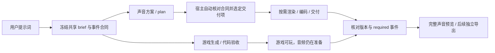

# 与新游戏生成管线协作

2026-11-16。目标是让一个独立音频产品服务于新游戏生成：用户描述一次游戏，游戏代码
与声音方案读取同一份设计与事件合同，分别生成，在版本一致时汇合。GameAudioLab
保持独立，不修改已有游戏，也不要求某一个游戏生成器成为它的内部模块。

当前接口的请求/响应与后续两阶段按需交付协议统一见
[API-INTERACTION](API-INTERACTION.md)。本文侧重生成器接入、版本汇合、预览和导出。

## 本轮做到哪一层

本项目提供本地 `POST /api/audio/plan` 入口，接收共享 `gameBrief`、`eventContract`
与 `options.seed`，返回结构化音频计划。`/pipeline.html` 演示一个可独立运行的宿主：
游戏先可玩，音频在父页面用真实 Web Audio 渲染，完成后通过真实点击解锁。
小游戏运行在 `sandbox="allow-scripts"` 的不透明来源 iframe 内，不请求音频资源；
它经 MessageChannel 发送语义事件，由可信宿主持有音频引擎并执行播放。

这条演示验证的是集成边界与执行顺序。游戏是预先编写的小游戏，音频导演仍是三类
关键词规则与 seeded composer，没有调用任意提示词 AI 模型。当前入口也没有后台
渲染队列、持久化音频包缓存或完整独立游戏导出器。原游戏仓库只作只读接入分析，
没有接线、部署或替换已有生成流程。

`createAudioPackage(plan)` 当前只输出 source manifest，`files` 为空且状态为
`not-rendered`。这可保存设计与依赖身份，不能被当成已导出的媒体包。

当前宿主桥已有真实浏览器验证：[15 项检查](../artifacts/pipeline-browser-validation.json)
全部通过，覆盖游戏先可玩、opaque/无网络、真实三层渲染与播放、有效 PCM、用户手势、
事件到声音、暂停恢复、旧版本/错版拒绝、音频失败隔离与手机布局。本机一次 neon
实测中，固定小游戏 0.02 秒可玩，三层声音任务 23.07 秒就绪，离线渲染内部计时约
23.05 秒。这不是跨设备或任意生成任务的性能保证。

[39 项管线合同检查](../artifacts/pipeline-validation.json) 使用模拟 runtime，验证身份
汇合与 adapter 行为；它与真实浏览器的 PCM 验证分别记录。两者都不表示生产旧项目
已完成接入、规则导演具备任意 AI 创作能力，或独立媒体包已经导出。

## 当前生成器的真实接入点

以下来自 2026-11-16 的源代码检查。路径以各仓库为根，描述实际调用边界，后续修改
应在生成器自己的适配层完成，而非让音频服务依赖它们的私有源码。

| 接入方 | 当前位置 | 建议接入动作 |
|---|---|---|
| AI Game | `src/contexts/CreatorContext.jsx` 的 `startGeneration` | 创建任务时冻结共享 brief/事件合同；用同一取消作用域派发游戏与音频任务，分别保存状态 |
| AI Game | `src/services/directGenerationService.js` 的 `buildDirectGenerationRequest` | 保留原提示词、参考说明与玩法限制；共享设计不能只保存关键词导演猜出的风格 |
| AI Game | `src/services/directGameService.js` 的 `runDirectGamePipeline` | 通过 `onStage` / `onArtifact` 报告游戏进度；其 `files/project/html` 结果留待音频任务汇合，音频失败不重新调用游戏模型 |
| AI Game | `buildDirectSystemPrompt`、`DIRECT_MODE_SYSTEM` 的音频规则及 `PROCEDURAL_ART_RULES` | 仅对选择新音频服务的新任务启用 host bridge 合同，避免模型继续生成另一套振荡器与音频时钟 |
| AI Game | `src/components/GamePreviewFrame.jsx` | 在可信父宿主挂音频桥；iframe 仍无 `allow-same-origin`，卸载、重开、切游戏时关闭连接并释放音频 |
| AI Game | `src/services/multiFileProject.js`、`src/utils/zipWriter.js` | 分别处理 srcdoc 的模块内联与导出的本地文件；不能把同一条 `/assets/...` URL 同时当作预览和导出路径 |
| ArcaneGame | `server/routers.ts` 的 `game.generate` / `game.patch` | 当前入口调用 `server/game/freegen.ts`，适配应放在此任务层或相邻编排层 |
| ArcaneGame | `server/game/freegen.ts` 的 `freeGenerate` / `freePatch` | `createGameDesign` 后、生成代码前冻结共享合同；复用 `signal`、预算与 `onStage`，音频有自己的子任务预算 |
| ArcaneGame | `shared/game/design.ts` 的 `arcane.design.json` | 保存原始需求、推断默认项、变更与验收要求；将其规范化为音频 brief，避免音频另猜玩法 |
| ArcaneGame | `shared/game/bundle.ts`、`client/src/lib/gamePreview.ts` | 两处共用离线 bundle；预览与导出都必须携带相同音频版本及可解码资源 |
| ArcaneGame | `server/routers.ts` 的 `saveVersion` / `publishVersion` | 合并版本后重新绑定验收摘要；原来无音频产物的验证凭据不能作为新整包的验收证明 |

ArcaneGame 仍保留 `server/game/agentService.ts` 的模板式生成逻辑，但当前主路由走
`freeGenerate`。因此不把那个历史模板入口当作本次首选接入位置。

## 从一份设计派发两条任务



共享 brief 要描述世界、核心循环、状态、动作、维度、节奏与音乐意图。原始用户要求
与系统推断值分开保存。图像参考只能补充，不能替换玩法；用户请求真实 3D 时也不能
因音频只有三个风格而改变游戏维度。尚未覆盖的声音风格应给出明确能力限制。

生产编排层先验证并规范化共享 JSON，再生成内容摘要。所有工作持有
`projectId + briefRevision + briefHash + eventContractVersion`。同一任务的任意一个
内容字段改变都建立新 revision；旧结果保留为历史，但不能盖住新的游戏或声音。
事件合同的内容也要参与摘要，不仅比较一个手填版本号。

当前模块的规范字段为 `projectId/revision/briefHash/contractVersion/contractHash`；
输入 `briefRevision` 会归一为 `revision`。规范化事件按 ID 排序，JSON 键排序后以
SHA-256 计算摘要。计划另带 `planId/scoreHash` 与编译器、作曲器、音源版本。

游戏生成输入除玩法需求外，附固定的音频客户端能力与事件清单。要求代码在真实行为
成立时发事件，例如拾取结算成功发 `item.collect`，而非每帧碰撞都发。音频任务接收
完全相同的合同，产出事件到音源/配方的映射。绑定缺失、未知事件和频率超预算应当
可观察；不应默默替换成任意 beep 后报告完成。

本轮并未把规则导演改造成 AI。未来 AI 层可以输出受约束的 MusicScore/SfxSpec，
仍需通过相同的版本、音域、节奏、授权音源和资源校验；服务端不执行模型临时编写
的任意 DSP 或下载模型随意指定的素材 URL。

正式合作分成方案和交付两阶段。第一阶段只形成有摘要的声音方案与可交付项；第二
阶段由宿主自动核对 identity、事件覆盖与预算，选择所需 items 后触发渲染。这个确认
是调用方的程序校验，不增加逐个音效的人工批准步骤。游戏代码生成仍可同时推进，
不需要等待所有媒体文件齐备。

当前演示已在收到 plan 后校验共享身份，再在浏览器渲染完整乐谱；它尚未实现未来
`acceptedItems` 选择和后台 job API。媒体交付后，宿主或独立游戏 adapter 在本地
解码、播放、混音与触发事件；运行中的拾取、命中不向生成服务请求新声音。

## 可运行的 API 与客户端合同

启动 `npm start` 后，宿主页面可以提交以下请求。它只规划谱面与绑定，不会在服务器
启动音频渲染；返回 plan 的 `mediaStatus` 仍为 `not-rendered`。

```js
const gameBrief = {
  schemaVersion: 1,
  projectId: 'island-demo',
  revision: 1,
  prompt: '温暖海岛上的收集游戏，轻柔的木琴配乐'
};
const eventContract = {
  schemaVersion: 1,
  version: 1,
  sceneStates: ['menu', 'exploration', 'result'],
  events: [
    { id: 'item.collect', cue: 'collect', required: true, maxRatePerSecond: 6 },
    { id: 'player.hit', cue: 'hit', required: true, maxRatePerSecond: 3 }
  ]
};
const response = await fetch('/api/audio/plan', {
  method: 'POST',
  headers: { 'Content-Type': 'application/json' },
  body: JSON.stringify({ gameBrief, eventContract, options: { seed: 1701 } })
});
const result = await response.json();
if (!response.ok) throw new Error(result.error);
const { plan } = result;
```

`GET /api/audio/capabilities` 返回当前三个风格、本地规则导演、浏览器 Web Audio 离线
渲染与消息桥能力。服务只监听本机，没有认证、跨域集成或多用户任务管理；生产接入
应由生成器可信后端调用独立服务，再把经过校验的计划交给宿主。

两条任务汇合使用 `createGameRevisionIdentity(gameBrief, eventContract)` 与
`validateGameAudioJoin(gameIdentity, plan)`，对五个身份字段逐一核对。游戏内部使用
由 `gameAudioClientSource()` 内联安装的客户端：

```js
await window.GameAudio.ready;
const answer = await window.GameAudio.emit('item.collect', { strength: 0.8 });
if (!answer.accepted) console.debug(answer.reason);
await window.GameAudio.setScene('exploration');
await window.GameAudio.setIntensity(0.6);
```

宿主用 `createGameAudioAdapter({ plan, runtime })` 校验声音操作，再以
`createGameAudioBridge({ iframe, plan, adapter })` 建桥。先 `connect()`，音频未准备时
保持默认禁用；渲染与手势解锁完成后，宿主 `adapter.start(rendered)` 并
`bridge.setEnabled(true)`。子游戏没有 unlock/start/dispose 权限。具体生命周期示例
以 `src/pipeline-demo.mjs` 为准；`npm run pipeline:check` 与 `npm run bridge:check`
可以独立验证合同和通道，不需要浏览器或付费模型。

当前 adapter 接受的声音负载是 `strength: 0..1` 和 `pan: -1..1`。`position` 会明确
返回 `unsupported-spatial-payload`；`setScene` 仅保存合同内状态，不自动推断音乐过渡，
动态层仍由显式 `setIntensity` 控制。合同内的 `maxRatePerSecond` 按相邻最小间隔执行。

## 预览先由宿主承载声音

AI Game 的直写合同要求组装结果零外部请求，预览是 opaque `srcdoc`。其
`resolvePreviewRuntimeAssets` 当前只重写批准的引擎 runtime 脚本，不是通用音频
素材加载器。把音频服务地址或相对 WAV 路径写进生成的游戏，不会自动获得可用的
离线资源；直接 `fetch` 还会触发直写验证器的网络请求限制。

现有系统提示还强制游戏自己生成 Web Audio 振荡器音效。未来接入时，应为选择音频
服务的新任务显式切换声音合同：模型仅调用 `GameAudio`，由可信装配器注入客户端，
宿主持有声音图。无需让模型接触 `parent` 或自行建立通信。旧任务继续使用原来的
音频模式；不能在桥已播放时再运行一套模型自写 BGM/SFX，造成重复声音和多个时钟。

本轮采用的连接方式是：

1. 父宿主从独立音频服务取得 plan，准备所需音源，完成离线渲染。
2. 父宿主创建 bridge，只向当前 iframe 建立专用 MessageChannel，绑定当前 brief
   和一次连接 token。iframe 不接触服务凭据，也不指定任意文件 URL。
3. 游戏只使用合同内的事件、状态和强度消息。宿主验证 token、brief 摘要/版本和
   消息白名单，再转给音频 adapter。切换到新 iframe 时旧连接失效。
4. 在用户真实点击中恢复 AudioContext。游戏可以先玩；声音尚未就绪、浏览器尚未
   解锁和音频任务失败分别展示状态，避免把三者都表示为“正在生成”。
5. 暂停、恢复、静音、重开与销毁由生命周期事件统一驱动；离开预览时销毁运行时、
   端口与监听器。不能让旧游戏的尾音在新游戏中继续播放。

opaque iframe 的 `origin` 是 `null`，仅核对 origin 不足以认定来源。父宿主只把专用
端口交给当前 `iframe.contentWindow`；客户端核对初始消息的 `event.source === parent`。
双方握手绑定 session nonce、brief 摘要和 revision，随后只在该端口接受受限消息，
并用单调 sequence 排除旧请求。游戏消息不能决定音源 URL、宿主操作或服务调用内容。

预览中的事件只传控制数据，音乐 PCM 不通过每次 `postMessage` 重复拷贝。后续加入
真实 3D 空间音频时，合同还需规定坐标单位、listener 更新频率和同一世界变换；当前
运行时仅支持立体声 pan，没有通过 HRTF、遮挡或距离衰减验证。

## 任务状态、部分就绪与错误恢复

一个总 `status=done` 无法描述两条并行任务。建议协调器分别存储：

| 状态组 | 建议字段 | 表达的含义 |
|---|---|---|
| 身份 | project / brief revision / brief hash / contract version | 本结果属于哪份设计 |
| 游戏 | `queued/running/ready/failed/cancelled`、artifact 摘要 | 游戏是否已经可玩 |
| 音频 | `planned/rendering/ready/failed/cancelled`、package 摘要 | 声音准备处于哪一步 |
| 播放 | `locked/unlocked/paused/stopped` | 浏览器运行态，不是生成任务状态 |
| 汇合 | `game-only/partial-ready/ready/incompatible` | 能否将当前两份结果一起使用 |
| 质量 | technical / binding / listening 状态 | 工程、触发与听感分别通过到哪一层 |

当前 plan API 是同步规划入口，没有假装返回后台 jobId。上表是后续持久化协调器的
合同建议，演示页面只实现其本地交互所需的状态。

| 情况 | 后续编排层应执行的动作 |
|---|---|
| 游戏先完成 | 保存可玩草稿，标明声音仍在准备；用户可开始体验 |
| 音频先完成 | 保存对应版本的 plan/包，等待同版本游戏，不修改其他版本 |
| 音乐失败但 required SFX 已可用 | 标为 `partial-ready`；保持可玩，并提供仅重试音乐 |
| required SFX 缺失 | 允许无声草稿预览，但不通过完整声音交付门槛 |
| 音频失败 | 保留游戏，不整条重新生成；重试失败阶段并保留错误原因 |
| 用户修改玩法 | 新建 brief revision，取消旧任务；迟到结果不得进入新汇合 |
| 只调整音乐风格 | 新建音频修订并复用事件兼容的游戏，重新做声音绑定验收 |
| 保存失败 | 保留已生成结果，重试保存；避免重复扣费或再调用两个生成任务 |
| 取消/超时 | 向两条子任务传取消信号；已提交的不可变产物可留缓存，不能发布为新版本 |

只有整套资源与绑定通过验收，才标记“完整声音已就绪”。人类听审尚未完成时，即使
技术门槛通过，也必须保留 listening pending；一次八事件的小样本盲听不能被扩大为
每个新游戏的听感验收。

## 独立导出需要第二种适配器

宿主桥解决编辑器预览，独立导出仍需完整可运行的播放端。当前演示没有声称 ZIP
已能离开宿主播放。正式产品应输出标准音频包及两种明确的装配方式：

| 产物 | 声音由谁播放 | 路径与装配要求 |
|---|---|---|
| 编辑器 opaque iframe | 可信父宿主 | 通过事件桥，无 iframe 资源请求 |
| 独立目录/ZIP | 游戏内本地 adapter | `audio/manifest.json` 与相对音频文件；通过本地 HTTP 服务运行 |
| 单文件离线 HTML | 内联本地 adapter | 把允许资源编码为内联数据或字节表，解码为 Blob/AudioBuffer；保留许可与资源摘要 |

AI Game 的 `zipWriter.createZip` 已支持 `encoding: 'base64'` 的文件项，可以作为
后续二进制导出的接入基础；但 `runDirectGamePipeline` 当前把模型输出作为 UTF-8
源代码处理，不能因此宣称任意音频资源已经走通整个保存/预览/导出链。

ArcaneGame 当前 `GameFile` 是字符串内容，验证限制为 40 个文件、400,000 bytes/文件、
3,000,000 bytes 总量；`bundleGameArtifact` 有 8,000,000 bytes 的展开上限。它现有
MIME 映射不包含 WAV/MP3，资源 `gameDataUrl` 与本地 fetch adapter 处理的是文本。
把二进制 base64 字符串塞进普通 `content` 不等于正确音频；需要显式 encoding/MIME/
byte length 合同，或在可信打包器中生成内联的音频字节表，再验证文件大小与解码。
其 bundle CSP `connect-src 'none'` 也不能因音频接入而被当成任意网络权限。

导出 URL 不能携带研究服务器的 `127.0.0.1`、机器绝对路径或短期会话地址。每个
资源用包内相对路径和真实 SHA-256 定位；移动目录、路由前缀与 CDN 地址由装配器
处理。单文件 base64 有约三分之一的体积开销，还可能在页面解析时重复占用内存，
因此不应把所有分轨和整个音源库无条件内联。

## 资源预算、缓存与交付门槛

建议首次正式联调只选一条游戏类型和一套声音风格，音乐时长、分轨数、采样率、
SFX 变体数与 voice 上限均由预算约束。先交付轻量 SFX 和单首 mix，完整分轨作为
支持动态音乐时的增量资源。按游戏需要下载，避免把全部测试曲加载进每款游戏。

现有实测 16 小节 BGM 在研究机器离线渲染约 20–32 秒；一首 mix 加三分轨保留的
Float32 PCM 为 46.72–66.09 MB。约 970 KB 的精选音源不包括这部分音乐 PCM。
这支持把完整音乐渲染放到生成阶段并缓存，不能作为即时生成或移动端预算承诺。

建议缓存键包含：规范化 brief/合同摘要、AudioSpec/Score、seed、作曲器/配方版本、
音源真实摘要、渲染配置、采样率与编码器版本。计划缓存、渲染缓存、传输编码缓存
分别寻址。相同输入可以复用已完成产物；渲染器不同也不能只靠 seed 假定输出逐位相同。
当前本地服务器的音源响应缓存，不等于已经实现了这种持久化音频任务缓存。

完整交付前至少核对：

- 游戏和音频身份一致，全部 required 事件已绑定，未知事件报告可见。
- 音频可解码、非静音、数值有限；循环、峰值、响度与文件/PCM/声部预算满足配置。
- 实际玩法中的关键行为触发正确，重复触发、暂停恢复、重开与离开不会泄漏声音。
- 预览和独立导出都找到相同版本资源；无研究服务器或机器路径依赖。
- 技术、绑定与主观听感分别记录；用户原始盲听记录不随项目产物公开。

## 后续服务 API 的最小演进

本轮已实现的入口保持简单：`POST /api/audio/plan` 接收
`{ gameBrief, eventContract, options: { seed } }`，成功返回 `{ plan }`。真实字段与校验以
`src/game-audio-pipeline.mjs` 为准，不把旧草案当成已部署的 HTTP 协议。

有后台渲染需求后再增加独立任务服务，例如以下**尚未实现**的资源：

| 方法与资源 | 职责 |
|---|---|
| `POST /v1/audio/plans` | 生成方案及候选交付项，返回方案身份与摘要，等待宿主按合同自动确认 |
| `POST /v1/audio/jobs` | 宿主确认后提交 `planId/planDigest/identity/acceptedItems/delivery`，只对选中的交付项开始渲染；以幂等键建立任务 |
| `GET /v1/audio/jobs/:id` | 返回阶段、可用组件、错误与当前 revision，不把音频字节混入状态 JSON |
| `DELETE /v1/audio/jobs/:id` | 取消未完成工作；重复取消幂等 |
| `POST /v1/audio/jobs/:id/retry` | 对同一设计仅重试失败组件，预算与幂等范围明确 |
| `GET /v1/audio/packages/:digest/manifest` | 读取不可变 manifest、资源摘要、相对路径、许可和质量状态 |

字段、确认条件和交互示例以 [接口交互协议](API-INTERACTION.md) 为准。以上 `/v1`
端点都尚未实现，不是当前 `/api/audio/plan` 的别名。交付资源准备好后进入本地播放，
`GameAudio.emit` 等运行时事件也不会转成后台生成请求。

版本汇合由游戏生成器的编排器负责，音频服务只承诺自己的输入输出合同。这样更换
游戏模型、引擎或编辑器时，声音产品可以独立演进；也能在同一游戏草稿上迭代音乐，
而不重新生成整款游戏。
