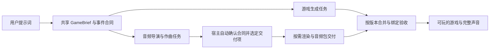

# 独立游戏声音生成项目：管线合同草案

版本：研究草案 0.1，2026-11-16。

这个项目的目标是接收用户的游戏需求，与游戏生成并行地创作配乐和音效，最后将声音
绑定到实际游戏行为。它可以作为独立服务和运行时被不同游戏生成器调用。

当前原型验证了有限的作曲/音色/渲染流程和固定场景中的声音触发。它使用本地关键词
路由与确定性乐谱生成，没有调用通用 LLM，也没有从任意提示词生成完整游戏。
下文是完整产品的输入、输出及协作合同草案，不是已实现的线上 API。
本轮新增了本地 plan API、合同 adapter 和 opaque iframe 宿主演示；它们的当前字段、
实际接入点与实现边界见 [GAME-PIPELINE-INTEGRATION](GAME-PIPELINE-INTEGRATION.md)
及 `src/game-audio-pipeline.mjs`，不应将下方完整音频包草案当作现有 API。
当前调用示例与未来确认后按需交付协议见 [API-INTERACTION](API-INTERACTION.md)；
它明确区分已实现的 `/api/audio/*` 与尚未实现的 `/v1/audio/*`。

## 共享设计先于两个生成任务



游戏生成器和音频生成器不能各自猜测事件名称或世界设定。两者读取同一份有版本的
GameBrief；场景状态、动作含义和声音触发合同先形成，再并行产出游戏代码与声音。
AI 可以扩展事件提案，只有通过校验的最终合同才进入编译。

声音服务与宿主按两阶段合作：先规划并返回候选声音及可交付项，宿主自动核对共享
身份、required 事件与预算，选定实际需要的 items 后才触发渲染和交付。确认是程序
校验，不要求用户逐个批准音效。未来协议为 `POST /v1/audio/plans` 后提交
`POST /v1/audio/jobs`，再查询 job 与不可变 package manifest；这些端点目前未实现。

交付完成后，游戏运行时使用本地 adapter 播放已获得的资源、分轨与声音事件，不把
每次游戏操作送去实时生成。当前原型在浏览器完成渲染，已有 plan API 和宿主桥；
按 `acceptedItems` 选择的后台媒体交付仍是后续能力。

GameBrief 示例：

```json
{
  "schemaVersion": 1,
  "projectId": "island-fishing-demo",
  "briefRevision": 3,
  "prompt": "温暖的海岛钓鱼游戏，有轻柔海浪和清楚的咬钩反馈",
  "world": { "theme": "sunlit-island", "dimension": "3d", "mood": ["warm", "relaxed"] },
  "gameplay": { "loop": ["explore", "cast", "wait", "reel", "reward"], "pace": "gentle" },
  "sceneStates": ["menu", "exploration", "fishing", "reward"],
  "audioIntent": {
    "style": "warm-mallet-acoustic",
    "bpmRange": [84, 100],
    "musicStructure": "theme-with-variation",
    "vocal": false,
    "dynamicLayers": 3
  },
  "eventContractVersion": 1
}
```

保存规范化 JSON 的 `briefHash`，所有任务返回同一个 hash、revision 和 contractVersion。
用户改动玩法或音乐要求后创建新 revision；旧任务可以取消，迟到结果不能覆盖新版本。

## GameEventContract

每个游戏动作使用稳定的语义 ID，并给出触发条件、负载及频率，而不是让游戏代码
直接拼接音频文件路径。音频系统将语义 ID 映射为经过验证的声音。

```json
{
  "schemaVersion": 1,
  "events": [
    {
      "id": "fishing.cast",
      "trigger": "鱼竿成功抛出时一次",
      "payload": { "strength": "number:0..1", "position": "vec3?" },
      "spatial": true,
      "maxRatePerSecond": 3,
      "priority": 50,
      "required": true
    },
    {
      "id": "fishing.bite",
      "trigger": "进入玩家可响应的咬钩窗口时一次",
      "payload": { "urgency": "number:0..1" },
      "spatial": false,
      "maxRatePerSecond": 2,
      "priority": 90,
      "required": true
    },
    {
      "id": "item.collect",
      "trigger": "真实收获结算成功时一次",
      "payload": { "strength": "number:0..1", "rarity": "enum:common|rare|epic" },
      "spatial": false,
      "maxRatePerSecond": 6,
      "priority": 70,
      "required": true
    }
  ],
  "sceneStates": ["menu", "exploration", "fishing", "reward"],
  "intensity": { "range": [0, 1], "meaning": "当前玩法张力，不是总音量" }
}
```

单位也需要约定：三维位置采用游戏世界的米或明确的换算比例，时间采用秒，乐谱使用
拍单位，音量保存为 dB。UI 和关键反馈通常不随三维距离变小；世界声源才参与衰减。
数据范围需实际 schema 校验，示例中的字符串类型描述不是可执行验证器。

## 音频任务输入与 AI 的职责

建议服务入口接收 GameBrief、GameEventContract、音源能力清单和资源预算，而不是
只接收一句风格提示词。模型负责提出音乐主题、和声、段落、配器与声音设计意图。
受控编译器负责音域、拍长、声部数、曲式、已授权音色 ID 与输出预算。

模型输出的结构可包含：

- `AudioSpec`：风格、调性、BPM、乐器、段落和场景转换策略。
- `MusicScore`：以拍为单位的音符、力度、时值、声部、循环和 cue 边界。
- `SfxSpec`：事件、瞬态/主体/尾音组合、变体、优先级与并发规则。
- `EventBindings`：合同事件到声音 ID、音乐状态和短 cue 的映射。

不让模型提供任意可执行 DSP 代码、任意 npm 包名或外部样本 URL。新增风格和乐器
通过平台能力清单扩展。模型输出失败时返回结构化错误，保留可编辑草稿与错误证据。

当前的 `directPrompt` 是上述音频导演位置的有限本地模拟；`composeScore` 是确定性
编排器。将来可替换导演层，但不能仅把本地规则函数改名为 AI 服务便宣称完成接入。

## 输出 AudioPackage

独立音频包应该同时支持试听、动态运行和后续编辑。只给一个 `mix.ogg` 无法保留
场景动态层、事件含义、谱面或可重现信息。

以下是未来媒体包的可选目录布局，实际媒体打包尚未实现。只交付宿主确认选中的
items；mix、stems、cues 不要求全部生成或打包。

```text
audio-package/
  manifest.json
  game-brief.json
  event-contract.json
  audio-spec.json
  score.json
  event-bindings.json
  music/
    preview.ogg
    stems/core.ogg
    stems/texture.ogg
    stems/rhythm.ogg
    cues/victory.ogg
    cues/failure.ogg
  sfx/
    cast-01.ogg
    bite-01.ogg
    collect-01.ogg
  runtime/
    version.json
  provenance/
    assets.json
    LICENSES.txt
  quality/
    report.json
```

混合试听不一定等同运行时实际动态混音。manifest 应明确 stem 的增益、循环起止点、
样本率、同步方式与动态规则，避免把所有分轨直接相加而改变混音。
后续媒体交付默认使用 **Opus + Ogg 容器（`.ogg`）**，交付采样率为 **48 kHz**，
MIME 为 `audio/ogg; codecs=opus`。BGM 默认立体声 64 kbps VBR，复杂配器或高质量档
为 96 kbps VBR；SFX 默认单声道 48 kbps VBR，32 kbps VBR 仅作为需试听批准的紧凑档。
宿主根据实际播放/解码能力选择默认格式或 AAC-LC/M4A 回退，每个交付项只交付一种
选定格式，不默认同时打包两套。回退时记录实际 MIME、codec、采样率与编码器版本。

WAV 保留作研究或母版，不作为正式媒体交付默认；现有 WAV/MP3 研究产物与原来的
44.1 kHz 实测记录保持不变。压缩后文件变小，解码为 PCM 后的内存仍需单独计算。
格式选择与协商详见 [默认媒体输出格式](API-INTERACTION.md#默认媒体输出格式)。

manifest 的关键字段：

```json
{
  "schemaVersion": 1,
  "packageId": "content-addressed-id",
  "projectId": "island-fishing-demo",
  "briefRevision": 3,
  "briefHash": "sha256-of-canonical-brief",
  "eventContractVersion": 1,
  "compilerVersion": "0.1.0",
  "soundBankVersion": "0.1.0",
  "seed": 1407,
  "sampleRate": 48000,
  "music": { "bpm": 92, "meter": 4, "bars": 16, "stems": [] },
  "files": [{ "path": "music/preview.ogg", "mimeType": "audio/ogg; codecs=opus", "container": "ogg", "codec": "opus", "sampleRate": 48000, "channels": 2, "bitrateKbps": 64, "bitrateMode": "vbr", "sha256": "file-digest", "bytes": 0 }],
  "qualityStatus": "technical-pass-listening-pending"
}
```

路径、摘要和 bytes 必须由打包器依据真实产物生成，不能从模型输出直接信任。
上例是尚未实现的媒体 manifest 草案，`bytes: 0` 和摘要为占位，不能当作现有产物；
`music.stems` 也仅在选中分轨交付时列出实际提供的分轨。
音色内容许可与代码依赖许可分别保存。相同谱面、音色、编译器和采样率可命中缓存；
跨浏览器 DSP 输出不保证逐位相同，因此缓存也要记录渲染配置。

## 运行时与游戏侧连接

```js
await audio.unlock(); // 真实用户手势中启动
audio.setScene('exploration');
audio.setIntensity(tension);
audio.playEvent('fishing.cast', { strength: castPower, position: rodPosition });
```

完整接口还需暂停、恢复、静音、停止和销毁。音乐切换在允许的拍/小节边界发生；
直接操作音效不能继承音乐的长 lookahead。音效优先级、voice budget 与事件冷却
由统一运行时控制。浏览器受限、样本缺失或音频初始化失败时应输出可观察的错误状态，
不能让游戏画面崩溃，也不能将静音当成验收成功。

## 两条任务如何汇合

游戏任务与音频任务各自报告 `queued/running/ready/failed/cancelled`，以项目和 brief
版本归档。可播放预览先保存草稿，不必等待所有高质量音频完成；最终完整交付必须确认：

1. 游戏运行的是当前 GameBrief revision，声音包也绑定当前 revision。
2. 所有 required 事件在真实玩法中触发，且音频运行时接受并产生有效输出。
3. 场景切换、重复事件、胜负、暂停、恢复和重开不会重复创建未释放音频节点。
4. 音频技术验收通过；人类试听状态独立保存，不能用“无削波”推断“好听”。

声音包单独修改时可以复用游戏产物；玩法事件合同变化时，则重新校验绑定并使旧验收
失效。资源或音频任务失败应保留明确状态，不能在界面显示“全部完成”。

## 当前研究原型与未来能力

| 能力 | 当前状态 |
|---|---|
| 三种游戏主题的结构化 brief / score | 已有，本地规则与 seeded composer |
| Tone / Web Audio 离线渲染与可试听 PCM | 已有，性能以实际报告为准 |
| 混合采样与程序合成对照 | 原型支持，音色范围有限 |
| 分轨、强度与通用音效事件 | 原型支持 |
| 固定等距场景中的声音触发 | 已有，是演示沙盘 |
| 共享设计/事件校验、plan API 与游戏 adapter | 已有，本地规则规划，不是通用 AI 导演 |
| opaque iframe 与宿主事件桥 | 已有，父宿主播放，小游戏不加载声音资源 |
| 游戏先可玩、音频随后准备的宿主演示 | 已有，游戏为预先编写的接入样本 |
| 任意提示词的 AI 音频导演 | 未接入 |
| 同步生成任意完整游戏 | 未实现 |
| 上述完整 AudioPackage 打包器/API | 设计草案，未实现 |
| 通用高质量或商业成品音质认证 | 未获得，仍需实际试听 |

下一步宜将已实现的 plan API/adapter/事件桥接到一条真实游戏生成任务，再实现完整
AudioPackage 打包器和独立导出，逐步接入 AI 导演。现有网站只是可能的接入方，
本轮没有修改它们。
