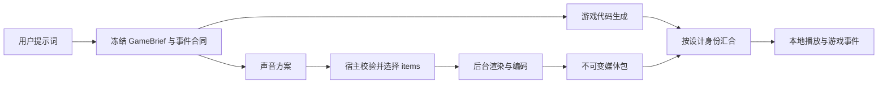

# 游戏生成与声音交付合同

版本：v1，2026-11-17。HTTP 见 [API-INTERACTION](API-INTERACTION.md)，交付运维见 [HANDOFF](HANDOFF.md)。

游戏与声音读取同一设计，游戏先完成可先无声游玩。游戏模型负责真实行为与事件，音频服务负责受支持的创作/渲染/编码/包，宿主负责授权、版本、装配与手势。当前仓库小游戏是预编写样本，没有通用游戏生成模型，也未改外部游戏项目。

## 共享身份

GameBrief 至少包含 schemaVersion:1、非空 projectId/prompt、正整数 revision，原始需求与玩法限制保留在共享 JSON。briefRevision 是兼容输入。影响内容的修改建立新 revision。

GameEventContract 含 schemaVersion:1、正整数 version、唯一 sceneStates 和 events。每事件有稳定 id（如 item.collect）、受支持 cue 或可选 null、required、可选 maxRatePerSecond。required 必须有 cue；频率执行为相邻最小间隔，不能每帧碰撞都触发。

normalizeGameBrief/normalizeEventContract 归一文本和字段，事件按 ID、场景按值排序。canonicalJson 对对象键排序、保留数组顺序，只接受有限 JSON。createGameRevisionIdentity 生成 `projectId/revision/briefHash/contractVersion/contractHash`；两个 hash 覆盖完整归一内容。validateGameAudioJoin 逐项检查，迟到旧任务不能覆盖新 revision，仅比较版本号或 prompt 不够。

## 三种产物

| 类型 | 来源 | 内容 |
|---|---|---|
| game-audio-plan | createAudioPlan / 旧 api/audio/plan | 身份、音频 brief、谱面、scoreHash、绑定，未渲染 |
| audio-delivery-plan | POST v1/audio/plans | identity/sourcePlan/items/delivery/versions/estimates 与内容摘要，等待确认 |
| audio-media-package | 后台 job | 实际媒体、事件/音乐映射、trim/loop、来源、质量、实测预算与 packageId |

createAudioPackage(plan) 仍是旧合同导出，files:[]、mediaStatus:not-rendered，不是后台交付器。sourcePlan.audioSpec 保留旧引擎 44.1 kHz 和 stereo-pan-only 的描述；实际交付以 item/文件的 **48 kHz** 与新播放器能力为准。

## 创作与算法边界

默认 local 只有 cozy/neon/ruins，关键词选配置，seed 决定乐句。默认作曲器为 16 小节、4/4、A8+B4+A′4 的六声部作品。同 plan 的音乐 slots 共享同一主题，不是不同场景的独立曲。海岛 hybrid 使用准备好的 VSCO2 木琴，其余主要合成；hybrid 不表示自动写实配器。

支持 cue：ui、collect、cast、splash、footstep、footstepWood、hit、laser、charge、explosion、victory、failure。声音素材/配方与玩法事件分开，绑定由共享合同唯一决定，不采用导演私自猜出的别名。

已实现两种算法替换入口：

- `GAME_AUDIO_DIRECTOR_MODULE` 指向运维信任的本地模块，导出 version、directPrompt(prompt,{seed})，可选 composeScore(audioBrief,{gameBrief,eventContract})。模块可调用自己的模型，但输出数据；例见 [algorithm-plugin.mjs](../examples/algorithm-plugin.mjs)。
- `GAME_AUDIO_DIRECTOR_PROVIDER=openai-compatible` 调固定 Chat Completions URL，JSON schema 只接受 style/mode/bpm/rootMidi；保持 seed、16 小节、4/4。本地作曲器和音源仍负责生成声音，这不是端到端音乐模型。本轮未验证收费供应商或其听感。

导演校验三风格、major/minor、60–180 BPM、主音 MIDI 36–84、无符号 seed。注入 score 校验 1–16 track、至多 10,000 音符、支持的乐器/角色、音域/时值/力度/增益与 timing。一切 HTTP 输入不能指定模块、代码、下载 URL 或任意 DSP。最终作品上限 65 秒；调用方另设更小 maxDurationSeconds 时，超过该上限的完整作品会被拒绝，不会自动剪辑。

versions.algorithm 记录本地算法版本、或模块主文件 SHA/version、或远程 model/endpointHash，不保存密钥。模块主文件 hash 不递归覆盖所有依赖，部署者应固定它们。模型接通不代表音质通过。

## 选择、预算与任务

确认原样回传 planId/planDigest/identity/delivery，加 acceptedItems；全部 required 必选、optional 可省略。更改编码、seed、预算、分轨或设计都新建 plan。计划 required 估计超预算提前拒绝，可选候选不会强制消耗 required-only 预算；实际完整选择仍执行实测预算。

默认 48 kHz Opus/Ogg：BGM stereo 64 kbps VBR（high 96），SFX mono 48（compact-approved 32，听审由调用方负责）。AAC-LC/M4A 回退音乐 96、音效 64。每 item 只交付一种格式，mix 或三个 stems 按需选择。默认预算传输 12 MiB/PCM 64 MiB，上限 64/256 MiB；最多 32 items、64 events、4 music slots、SFX 1–3 变体（部分 cue 只支持 1）。

实际字节含编码和 provenance，PCM 按实际解码 Float32 帧计；浏览器还检查自身解码预算。约 970 KB 的精选原料不包含生成音乐 PCM；降低码率不会缩小解码内存。stems 和多作品常驻需单独预算。

任务有逐组件状态、requiredReady/allSelectedReady、selectionDigest 和错误。短 SFX 优先，部分就绪可发不可变包，新组件形成新 packageId。终态为 ready/partial-ready/failed/cancelled；失败可重试组件在新任务里重做，已完成组件复用。音频失败不重生成游戏。

本地文件存储 plan/job/package，单进程锁禁止同 dataDir 多服务；重启恢复未完成工作并校验缓存。默认并发 1，HTTP 支持 1–4。任务幂等按 owner/project 范围，缓存记录谱面/配方、真实素材、引擎/worker/Tone、编码器指纹。确认后受保护源码变更会拒绝旧 plan。

## 包与播放

manifest 包含设计/plan/selection 身份、accepted/delivered items、文件映射、实测预算、来源与质量。packageId 是除自身外规范 JSON 的 SHA-256，各文件另有长度/hash。包只含相对路径，WAV Float32 母版留服务缓存；运行不需要创作音源库、Tone 或模型。

SDK 校验后解码，player 从本地 AudioBuffer 播放。手势 unlock、同步 stems、变体轮转、强度、声部上限、暂停恢复和静音已实现。setScene 只记录元数据，切曲显式 music.play。运行中的动作不发生成 API。

旧 opaque iframe 桥仅传 emit/setScene/setIntensity，旧 adapter 只支持 strength/pan、拒绝 position。新 player 可给声明 spatial.enabled 的 mono SFX 使用 PannerNode HRTF/距离衰减，宿主更新 listener。没有遮挡、混响区域、连续声源移动或 Three.js 自动场景同步，也未完成完整 3D 生成游戏听审。旧桥接新包需显式宿主适配，不能把 bundle 直接当旧 Tone runtime。

quality.technical 表示渲染/解码，binding 当前只验证合同，listening 为 not-evaluated；它们不等于实际玩法和真人音质通过。exportAudioPackageZip 可输出媒体、manifest、许可、两份 runtime 与本地试听页，静态 HTTP 下脱离生成服务。它是声音包，未自动合并外部整款游戏或输出单文件 HTML；游戏装配、验收和发布由生成器负责。
